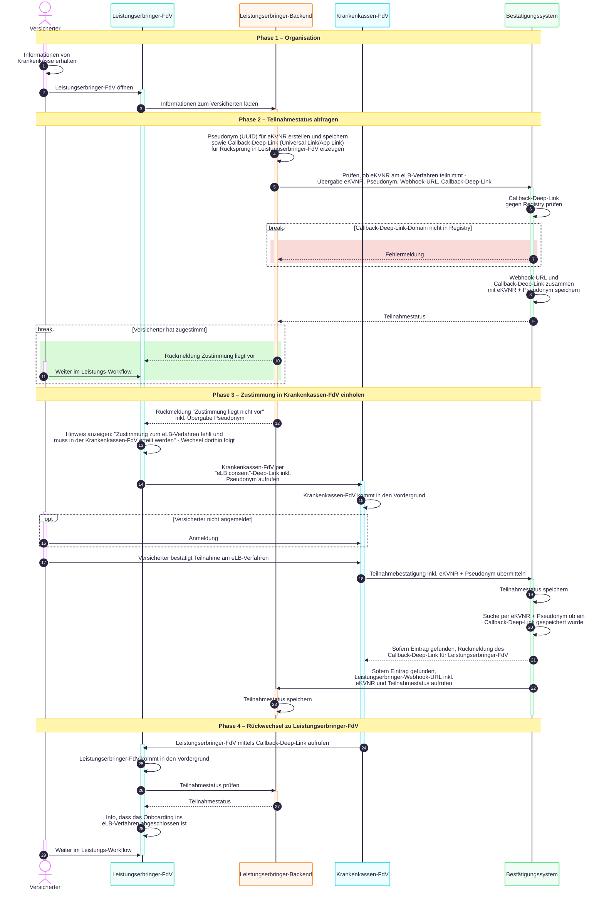
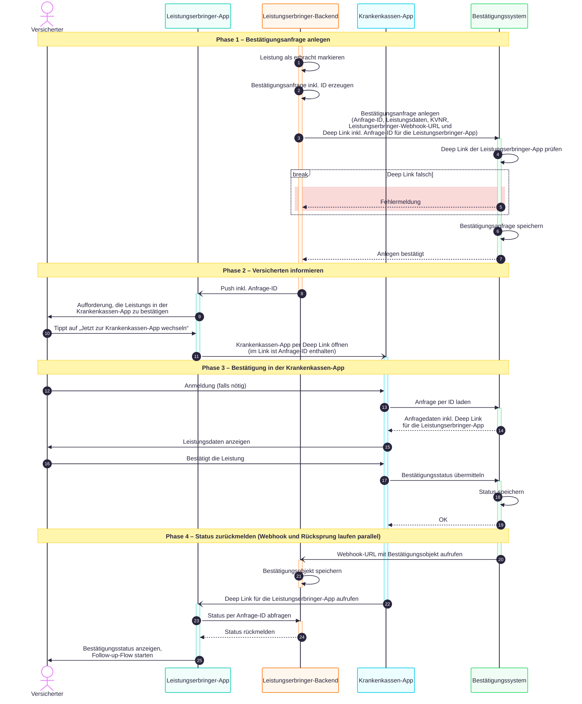

# App Interaktion Workflow

## Workflow Anmeldung "Happy Path"

**Offene Punkte**

Inhaltlich sind alle acht Punkte unverändert. Angepasst sind nur die Schrittnummern sowie bei Punkt 1 und 2 der Bezug auf den neuen Schritt 28.

1. **Race Condition zwischen Webhook und Statusabfrage (Schritte 21–28)**
Die Rückmeldung des Callback-Deep-Links an die Krankenkassen-FdV (21) und der Webhook-Aufruf (22) laufen faktisch parallel. Fragt die Leistungserbringer-FdV den Teilnahmestatus ab (26), bevor das Leistungserbringer-Backend den Webhook verarbeitet hat, erhält sie einen veralteten Status, und die Info in Schritt 28 wäre falsch. Lösungsoptionen: Das Leistungserbringer-Backend fragt bei noch fehlendem Webhook direkt beim Bestätigungssystem nach, oder das Bestätigungssystem ruft den Webhook auf, bevor es der Krankenkassen-FdV antwortet.

2. **Ablehnung der Zustimmung nicht modelliert (17, 28, 29)**
Abgebildet ist nur die Bestätigung der Teilnahme. Offen ist, wie eine Ablehnung an das Bestätigungssystem übermittelt wird und wie die Leistungserbringer-FdV darauf reagiert. Die Schritte 28 und 29 folgen derzeit unabhängig vom Teilnahmestatus.

3. **Kein Eintrag im Bestätigungssystem gefunden (21, 22, 24)**
Die Schritte 21 und 22 setzen voraus, dass ein Eintrag gefunden wird. Der Fall ohne Eintrag ist nicht beschrieben. Er tritt z. B. bei abgelaufenem Pseudonym auf oder wenn in der Krankenkassen-FdV ein anderer Versicherter angemeldet ist. Ohne Callback-Deep-Link entfällt Schritt 24. Offen ist, welche Rückmeldung die Krankenkassen-FdV erhält und wie der Versicherte zur Leistungserbringer-FdV zurückfindet, etwa über einen Hinweis zum manuellen Wechsel.

4. **Keine Registry-Prüfung der Webhook-URL (6)**
Geprüft wird nur der Callback-Deep-Link. Ohne Prüfung der Webhook-URL könnte das Bestätigungssystem Teilnahmestatus und eKVNR an beliebige Endpunkte senden.

5. **Fehlermeldung erreicht die Leistungserbringer-FdV nicht (7)**
Bei negativer Registry-Prüfung endet der Ablauf im Leistungserbringer-Backend. Offen ist, was dem Versicherten in der Leistungserbringer-FdV angezeigt wird.

6. **Ermittlung des Consent-Deep-Links der zuständigen Krankenkasse (14)**
Offen ist, woher die Leistungserbringer-FdV den „eLB consent“-Deep-Link der Krankenkassen-FdV des jeweiligen Versicherten kennt. Optionen: Das Bestätigungssystem gibt ihn zusammen mit dem Teilnahmestatus zurück (9), oder er wird aus den Genehmigungsinformationen abgeleitet.

7. **Krankenkassen-FdV nicht installiert (14)**
Ist die Krankenkassen-FdV auf dem Gerät nicht installiert, öffnet das Betriebssystem den Universal Link/App Link im Browser. Offen ist, welches Verhalten in diesem Fall vorgesehen ist, z. B. eine Webseite der Krankenkasse oder ein Hinweis zur Installation.

8. **Übermittlung der eKVNR im Webhook (22)**
Zur Zuordnung würde das Pseudonym genügen, da das Leistungserbringer-Backend die Zuordnung zur eKVNR in Schritt 4 gespeichert hat. Das entspräche besser der Datenminimierung. Der Punkt entfällt, falls die eKVNR bewusst übertragen wird.

## Workflow Bestätigung

